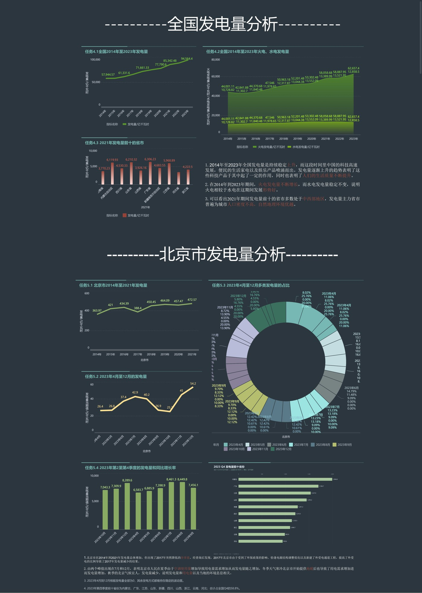

# 基于 FineBI 的发电量可视化分析

> 全国趋势、电源结构与北京市季节特征（2014—2023）  
> 2024 广卫·上进双创工作室项目｜2026 作品集修订版

[](https://www.finebi.com/) [](report/power-generation-analysis-report.pdf) [](#)

## 项目简介

本项目使用 FineBI 对全国及北京市发电量数据进行可视化分析，回答四个问题：

1. 2014—2023 年全国发电量的增长节奏如何？
2. 火电、水电和其他电源的结构如何变化？
3. 发电量在省级层面如何集中？
4. 北京市本地发电量的年度趋势与月度季节特征是什么？

项目从初版的“FineBI 操作记录”重构为“**分析问题—数据口径—发现—建议—局限**”的完整交付，包含仪表板、分析报告、指标说明和复现文档。



## 核心发现

- **总量**：全国发电量由 2014 年的 **57,944.57 亿千瓦时** 增至 2023 年的 **94,564.40 亿千瓦时**，累计增长 **63.2%**，年均复合增速 **5.6%**。
- **结构**：火电仍是最大增量来源，但占比由 **75.9%** 降至 **66.3%**；水电占比由 **18.5%** 降至 **13.6%**；其他电源占比由 **5.5%** 升至 **20.1%**。
- **区域**：2021 年发电量前十省份合计占全国 **57.7%**，形成“资源大省 + 负荷中心”并存的格局，不能仅用人口密度解释。
- **北京**：本地发电量 2014—2021 年增长 **29.8%**；2017 年出现 **-10.6%** 的异常回落；2023 年 12 月为月度峰值（54.2 亿千瓦时），7 月为次峰（42.9 亿千瓦时）。
- **2023 Q4**：全国 Q4 发电量 **22,642.8 亿千瓦时**，同比增长 **8.6%**；前十省份合计 **13,310.9 亿千瓦时**，占全国 Q4 的 **58.8%**，其中内蒙古（1,994.8，+17.3%）、广东（1,700.7，+10.3%）、江苏（1,537.0，+9.0%）居前三。
- **方法边界**：报告为描述性分析，不将图表相关性写成因果结论；北京市本地发电量不等于全社会用电量。

## 交付物

| 文件 | 说明 |
|---|---|
| [分析报告 PDF](report/power-generation-analysis-report.pdf) | 完整报告，含图表、口径、建议与附录 |
| [分析报告 DOCX](report/power-generation-analysis-report.docx) | 可编辑版本 |
| [分析报告 Markdown](docs/analysis-report.md) | GitHub 在线阅读版本 |
| [仪表板 PDF](dashboard/power-generation-dashboard.pdf) | FineBI 仪表板导出文件 |
| [FineBI 实现说明](docs/finebi-implementation.md) | 数据接入、计算字段、图表与看板搭建步骤 |
| [数据质量清单](docs/data-quality-checklist.md) | 单位、缺失值、零值、口径一致性检查 |
| [修订说明](docs/revision-notes.md) | 初版到作品集版的改动与改写理由 |
| [数据说明](data/README.md) | 来源、字段字典、时间范围与已知限制 |

## 仓库结构

```text
power-generation-dashboard/
├─ README.md
├─ dashboard/
│  └─ power-generation-dashboard.pdf
├─ data/
│  ├─ README.md                 # 来源、字段字典与已知问题
│  ├─ source/                   # 工作室提供的原始 Excel
│  │  ├─ national_annual_generation_2014_2023.xlsx
│  │  └─ provincial_monthly_energy_2022_2023.xlsx
│  └─ processed/                # 可复现的清洗/汇总数据
│     ├─ national_annual_2014_2023.csv
│     ├─ province_2021_top10.csv
│     ├─ q4_2023_all_provinces.csv
│     ├─ q4_2023_top10.csv
│     └─ beijing_monthly_2022_2023.csv
├─ docs/
│  ├─ analysis-report.md        # 完整报告（Markdown）
│  ├─ finebi-implementation.md  # FineBI 复现步骤
│  ├─ data-quality-checklist.md # 数据质量检查清单
│  └─ revision-notes.md         # 修订说明
├─ images/
│  ├─ 00-dashboard-overview.jpg
│  ├─ 01-national-total-trend.png
│  ├─ 02-thermal-hydro-trend.png
│  ├─ 03-top-provinces-2021.png
│  ├─ 04-beijing-annual-trend.png
│  ├─ 05-beijing-monthly-2023.png
│  ├─ 07-q4-top10-2023.png
│  ├─ 08-dashboard-preview.jpg
│  └─ supplementary/            # 初版补充图，未纳入主结论
├─ report/
│  ├─ power-generation-analysis-report.docx
│  └─ power-generation-analysis-report.pdf
└─ .gitignore
```

## 数据说明

数据由**工作室提供 Excel**，接收日期为 **2024 年 11 月 4 日**。原始文件已放入 `data/source/`，处理结果在 `data/processed/`：

- 全国年度发电量：2014—2023；
- 分省年度发电量：2014—2021（报告取 2021 年做区域对比）；
- 分省月度能源数据：2022.01—2023.12，31 个省（区、市）；
- 2023 Q4 分省汇总：31 省完整数据，可复现前十排名。

需要说明的数据问题：

- 太阳能列标题为“亿千瓦时”，但数值量级疑似“万千瓦时”，未用于总发电量和 Q4 排名；
- 初版 Q4 图只展示 4 省，本次已用 31 省月度数据重新汇总；
- 北京本地发电量不等于全社会用电量，不能直接推断用电需求。

> 数据版权归数据提供方所有。本项目仅用于学习与作品展示。

## 复现方式

1. 使用 `data/source/` 中的原始 Excel；
2. 在 FineBI 中上传数据表，建立“年份/年月/地区”维度与“发电量/火电/水电”指标；
3. 新建计算字段：火电占比、水电占比、其他电源、其他电源占比；
4. 按 [FineBI 实现说明](docs/finebi-implementation.md) 搭建 8 个图表与两个分析板块；
5. 对照 [`data/processed/`](data/processed/) 中的 CSV 复核关键数字，再阅读 [分析报告](docs/analysis-report.md)。

## 工具与方法

- **工具**：FineBI、Excel
- **方法**：趋势分析、结构分析、排名分析、异常识别、描述性统计
- **未使用**：因果推断、预测模型（缺少装机、来水、气温、电价、外受电等变量）

## 作者

**sherry**   
数据分析 / 数据运营方向

---

如果这个项目对你有帮助，欢迎 Star。若发现数据或口径问题，欢迎提 Issue。
