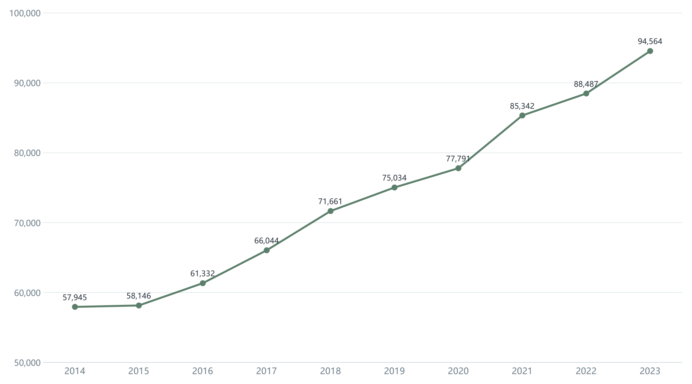
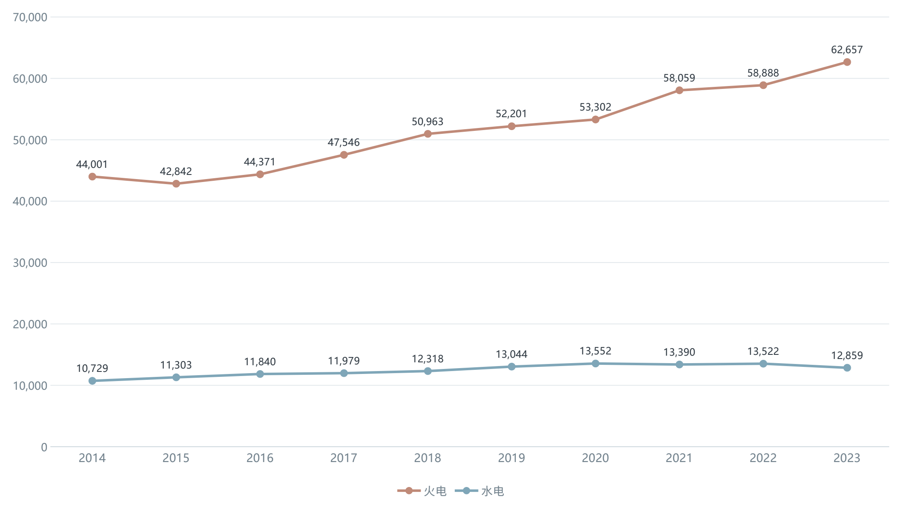
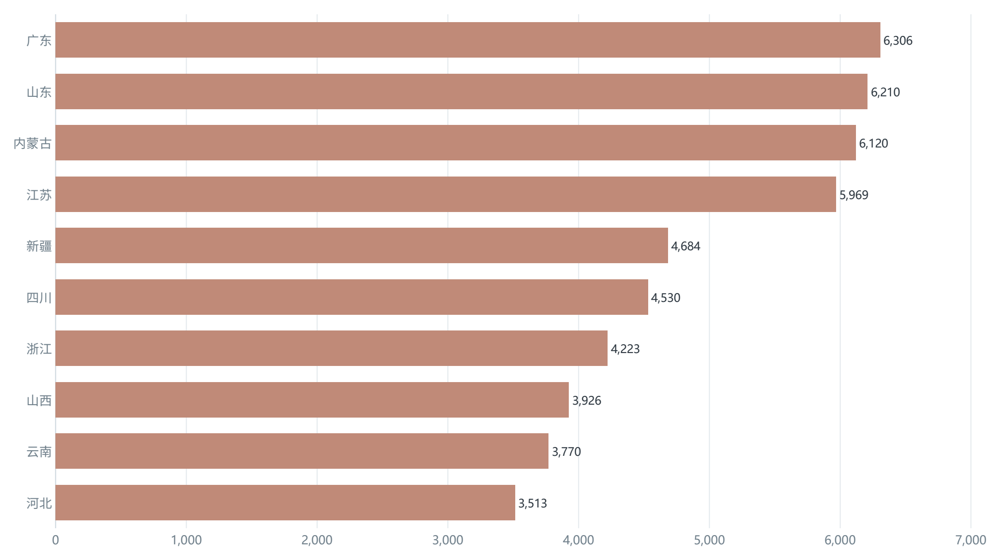
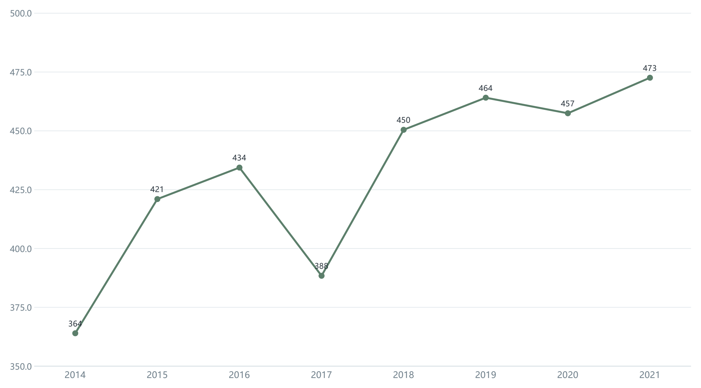
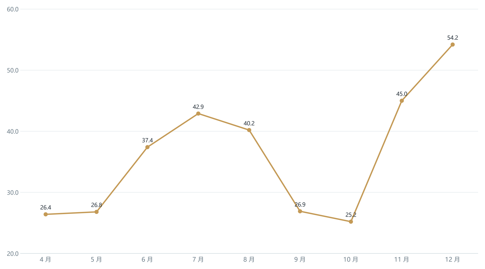
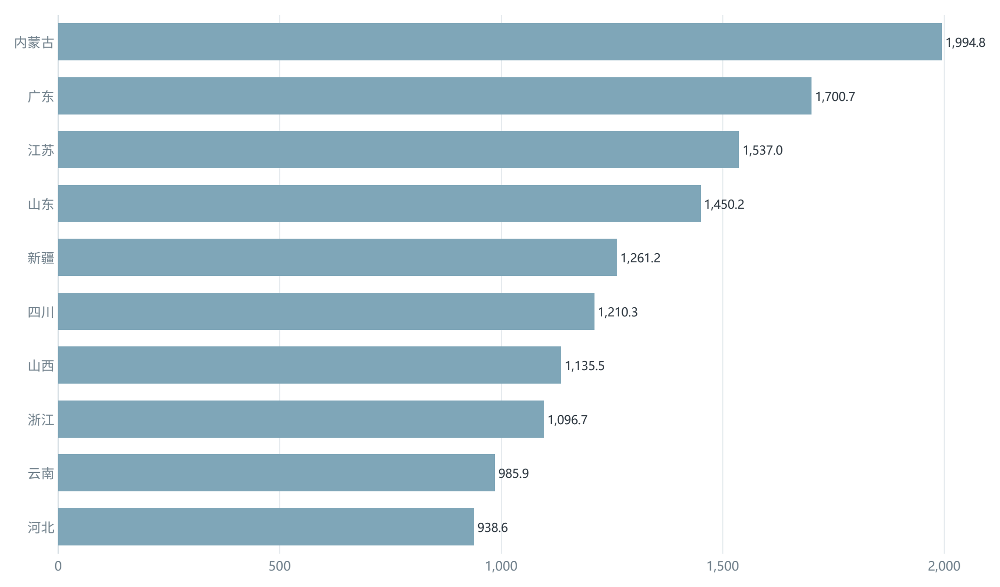
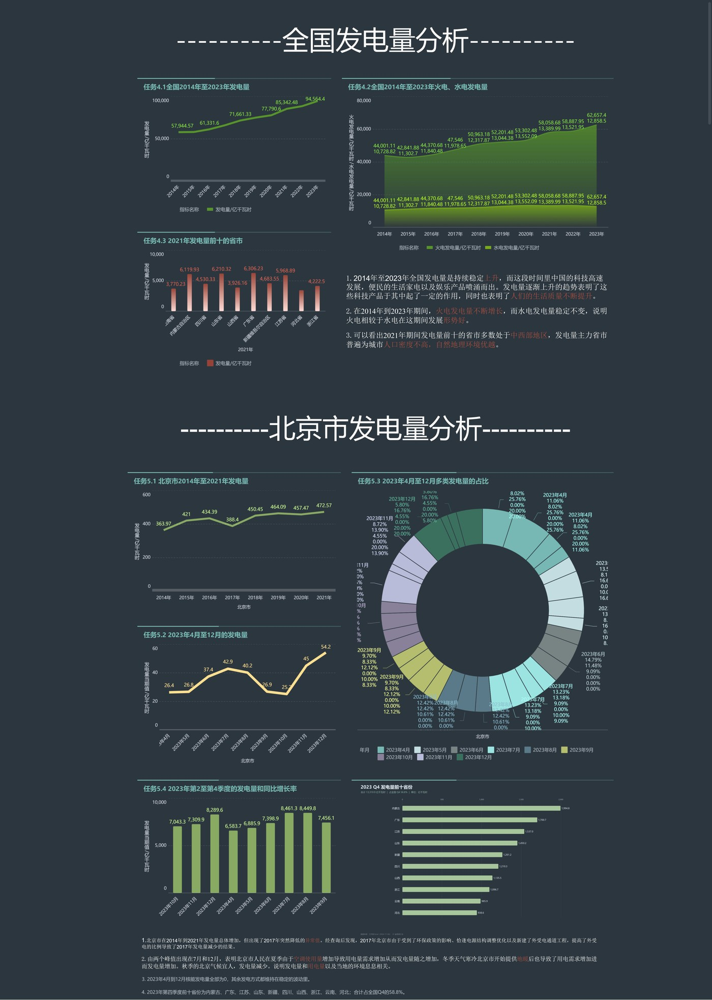

# 基于 FineBI 的发电量可视化分析

**全国趋势、电源结构与北京市季节特征（2014—2023）**

- 作者：陈奕蓝
- 项目来源：2024 广卫·上进双创工作室
- 版本：作品集修订版 v1.0｜2026 年 11 月
- 工具：FineBI、Excel

---

## 摘要

本报告使用 FineBI 对 2014—2023 年全国发电量、2014—2021 年北京市发电量及 2023 年 4—12 月北京市月度数据进行分析，围绕**总量趋势、电源结构、区域集中度和季节特征**四个问题搭建可视化仪表板。分析以描述性统计为主，不进行因果推断或预测。

核心结论：

| 维度 | 核心发现 |
|---|---|
| 总量 | 全国发电量由 2014 年的 57,944.57 亿千瓦时增至 2023 年的 94,564.40 亿千瓦时，累计增长 63.2%，年均复合增速 5.6%。 |
| 结构 | 火电仍是最大增量来源，但占比由 75.9% 降至 66.3%；水电占比由 18.5% 降至 13.6%；其他电源占比由 5.5% 升至 20.1%。 |
| 区域 | 2021 年发电量前十省份合计占全国 57.7%，形成“资源大省 + 负荷中心”并存的格局，不能仅用人口密度解释。 |
| 北京 | 北京本地发电量 2014—2021 年增长 29.8%，2017 年出现 -10.6% 的异常回落；2023 年 12 月为月度峰值，7 月为次峰。 |
| 2023 Q4 | 全国 Q4 发电量 22,642.8 亿千瓦时，同比增长 8.6%；前十省份合计 13,310.9 亿千瓦时，占全国 Q4 的 58.8%。 |
| 交付 | 完成全国与北京两个分析板块、8 个图表的 FineBI 仪表板，并沉淀本报告、指标口径与复现说明。 |

> **核心判断**：总量增长与结构清洁化同时发生。火电的绝对量仍在增加，但份额持续下降；因此不能用“火电增长”直接推导出“火电发展形势更好”。

本报告对初版中的三类表述做了降级处理：

1. 将“火电发展形势好”改为“增量主体但份额下降”；
2. 将北京 2017 年下降的政策解释标注为待验证假设；
3. 将“前十省份”中实际只展示 4 省的图表，改为基于 31 省月度数据的 Q4 季度汇总。

这些修订旨在让结论与证据强度匹配。

---

## 1. 项目背景与分析问题

### 1.1 业务背景

在能源转型和绿色发展的背景下，发电量数据是观察电力供给规模、电源结构和区域资源配置的基础指标。对全国数据而言，核心问题是总量增长与结构变化是否同步；对北京这类负荷中心而言，核心问题是本地发电的波动与季节性，以及本地发电与外部受电之间的关系。

本项目最初的交付形式是一份 FineBI 操作型报告，重点记录软件安装、图表制作和仪表板搭建步骤。作为作品集版本，本报告将叙述重心从“怎么做图”转为“为什么分析、发现了什么、建议做什么”，操作步骤则移至 [`finebi-implementation.md`](finebi-implementation.md)。

### 1.2 分析问题

1. 2014—2023 年全国发电量的增长节奏如何？
2. 火电、水电和其他电源的绝对量与占比如何变化？
3. 发电量在省级层面如何集中？哪些省份是主要贡献者？
4. 北京市本地发电量的年度趋势和 2017 年异常如何理解？
5. 北京市 2023 年 4—12 月的月度发电量呈现怎样的季节特征？
6. 如何用 FineBI 将上述分析固化为可复用的仪表板？

### 1.3 分析范围

| 分析对象 | 时间范围 | 粒度 | 主要用途 |
|---|---|---|---|
| 全国发电量 | 2014—2023 | 年度 | 总量趋势、电源结构 |
| 分省发电量 | 2021 | 年度 / 省级 | 区域集中度与排名 |
| 北京市发电量 | 2014—2021 | 年度 | 城市趋势与异常识别 |
| 北京市发电量 | 2023.04—2023.12 | 月度 | 季节性与峰值分析 |
| 重点省份发电量 | 2023.10—2023.12 | 季度 / 省级 | 第四季度 31 省汇总与前 10 排名 |

---

## 2. 数据说明与分析方法

### 2.1 数据来源与字段

数据由**工作室提供 Excel**，接收日期为 **2024 年 11 月 4 日**。原始文件已随仓库放在 `data/source/`：

- `national_annual_generation_2014_2023.xlsx`：全国年度及分省年度发电量；
- `provincial_monthly_energy_2022_2023.xlsx`：31 个省（区、市）2022—2023 年月度发电量。

其中，分省月度表共 744 行（31 省 × 24 个月），可支持 2023 年 Q4 汇总和月度同比分析。报告中的数值以原始 Excel 为准；处理后的可复现数据见 `data/processed/`。

| 字段 | 含义 | 单位 | 说明 |
|---|---|---|---|
| 年份 / 年月 | 统计时间 | — | 年度或月度 |
| 地区 | 全国 / 省（区、市） | — | 分省分析使用 |
| 发电量 | 总发电量 | 亿千瓦时 | 核心指标 |
| 火电发电量 | 火力发电量 | 亿千瓦时 | 分项指标 |
| 水电发电量 | 水力发电量 | 亿千瓦时 | 分项指标 |
| 核能 / 太阳能 / 风力 | 分电源发电量 | 亿千瓦时 | 北京月度结构分析使用 |

### 2.2 指标定义

| 指标 | 计算方式 | 解释 |
|---|---|---|
| 火电占比 | 火电发电量 ÷ 总发电量 | 衡量电源结构 |
| 水电占比 | 水电发电量 ÷ 总发电量 | 衡量电源结构 |
| 其他电源 | 总发电量 − 火电 − 水电 | 包含风电、光伏、核电等，属于派生口径 |
| 同比增长率 | （本期 − 上年同期）÷ 上年同期 | 原始材料缺少 2022 年月度数据，未计算月度同比 |
| 年均复合增速 | （期末值 ÷ 期初值）^(1/年数) − 1 | 用于跨年度比较 |

需要特别说明：**北京市本地发电量不等于全社会用电量**。北京外受电比例较高，本地发电量不能直接用来推断用电需求或经济景气度；本报告只将其作为本地发电侧的观察指标。

### 2.3 数据质量检查

- **单位统一**：全国和北京年度数据统一为“亿千瓦时”；Q4 已用 31 省月度表重新汇总，不再引用初版 4 省图表的绝对值。
- **零值与缺失值**：北京核电为结构性零值（本地无核电），不是缺失值；未对零值做删除或插补。
- **加总校验**：火电 + 水电 ≤ 总发电量；“其他电源”由差额计算，保留一位小数。
- **时间覆盖**：全国为 2014—2023 年完整年度；北京年度为 2014—2021 年；北京月度覆盖 2022—2023 年，报告重点分析 2023 年 4—12 月及同比。
- **单位疑点**：分省月度表的“太阳能发电量”列标题为“亿千瓦时”，但数值量级疑似“万千瓦时”；该列未参与总发电量和 Q4 排名计算，使用前需向数据提供方确认。
- **口径一致性**：初版 Q4 图只展示 4 省且是月度值，本次已用 31 省数据重新汇总为季度值；2019 年火电值以源表 52,201.48 为准。

### 2.4 分析流程

**数据接入 → 字段清洗与类型校验 → 计算字段（占比、增速）→ 图表选择 → 仪表板布局 → 结论与建议。**

在 FineBI 中，年度、月度、地区作为维度，发电量作为指标；通过筛选器控制年份、地区和电源类型；通过计算字段生成占比和同比；最终将全国板块与北京板块组合为一张仪表板。具体操作见 [`finebi-implementation.md`](finebi-implementation.md)。

### 2.5 方法边界

本报告使用趋势分析、结构分析、排名分析和异常识别，属于描述性分析。由于缺少装机容量、利用小时、来水、气温、电价、外受电和用电量等数据，本报告不进行因果推断，也不建立预测模型。

---

## 3. 核心发现

### 3.1 全国总量：十年增长 63.2%，增速呈阶段性波动

*图 1　2014—2023 年全国发电量（亿千瓦时）*

全国发电量从 2014 年的 57,944.57 亿千瓦时增至 2023 年的 94,564.40 亿千瓦时，累计增加 36,619.83 亿千瓦时，增幅 63.2%，年均复合增速 5.6%。

分年度看，2021 年增速最高（+9.7%），2020 年和 2022 年均为 +3.7%，2023 年回升至 +6.9%。这说明总量增长并非线性，受宏观经济、电力需求和供给条件共同影响；单看十年趋势会掩盖阶段性波动。

| 指标 | 2014 | 2020 | 2023 | 2014—2023 |
|---|---:|---:|---:|---:|
| 总发电量（亿千瓦时） | 57,944.57 | 77,790.60 | 94,564.40 | +63.2% |
| 同比增速 | — | +3.7% | +6.9% | CAGR 5.6% |

### 3.2 电源结构：火电仍是增量主体，但份额持续下降

*图 2　2014—2023 年全国火电与水电发电量（亿千瓦时）*

火电发电量由 44,001.11 亿千瓦时增至 62,657.40 亿千瓦时，增长 42.4%，年均复合增速 4.0%；水电由 10,728.82 亿千瓦时增至 12,858.50 亿千瓦时，增长 19.9%，年均复合增速 2.0%。

结构变化比绝对量更值得关注：火电占比由 75.9% 降至 66.3%，下降 9.7 个百分点；水电占比由 18.5% 降至 13.6%，下降 4.9 个百分点；以“总发电量 − 火电 − 水电”计算的其他电源占比由 5.5% 升至 20.1%，上升 14.6 个百分点。

从增量看，火电增加 18,656.29 亿千瓦时，其他电源增加 15,833.86 亿千瓦时，火电仍是最大单一增量来源；但从边际变化看，新增供给正在向其他电源转移。**“火电增长”与“火电份额下降”并不矛盾，前者是总量扩张的结果，后者是结构变化的结果。**

2023 年水电较 2022 年下降 4.9%，可能与来水条件有关，但本报告缺少水文数据，暂不做因果判断。

### 3.3 区域格局：前十省份占 57.7%，资源禀赋与负荷中心并存

*图 3　2021 年发电量前十省份（亿千瓦时）*

2021 年发电量前十省份合计 49,251.56 亿千瓦时，占全国 57.7%。广东（6,306.23）、山东（6,210.32）、内蒙古（6,119.93）位列前三，分别约占全国 7.4%、7.3%、7.2%。

这份名单不能简单解释为“人口密度低、自然条件好”。广东、山东、江苏、浙江既是经济与负荷中心，也是发电大省；内蒙古、新疆、四川、云南、山西则更多体现煤炭、水电、风光等资源禀赋。**区域发电格局是资源禀赋、装机布局、负荷需求和跨区输电共同作用的结果，单一人文或地理变量不足以解释。**

初版还包含一张 2023 年第四季度“前十省份”图，但实际只展示内蒙古、山东、广东、江苏四个省份，且为月度值。该图不纳入本报告结论；第 3.6 节改用 31 省月度数据重新汇总 Q4 前十。

### 3.4 北京年度：本地发电增长 29.8%，2017 年为异常点

*图 4　2014—2021 年北京市发电量（亿千瓦时）*

北京本地发电量由 2014 年的 363.97 亿千瓦时增至 2021 年的 472.57 亿千瓦时，累计增长 29.8%，年均复合增速 3.8%，低于全国同期 5.6% 的水平。

2017 年北京发电量降至 388.40 亿千瓦时，较 2016 年下降 10.6%；2018 年恢复至 450.45 亿千瓦时，同比增长 16.0%。初版材料将 2017 年下降归因于环保政策、电源结构调整和外受电通道投产，但未附政策文件、装机变化或外受电数据，本报告将其标注为**待验证的解释假设**，不作为因果结论。

北京本地发电增速低于全国，方向上与“负荷中心增加外受电”的解释一致，但仍需外受电和用电量数据验证。

### 3.5 北京月度：12 月与 7 月双峰，秋季为低谷

*图 5　2023 年 4—12 月北京市发电量（亿千瓦时）*

2023 年 4—12 月，北京月度发电量在 12 月达到 54.2 亿千瓦时的峰值，7 月为 42.9 亿千瓦时的次峰；9—10 月降至 26.9 和 25.2 亿千瓦时的低位。第四季度（10—12 月）合计 124.4 亿千瓦时，占 4—12 月总量 325.0 亿千瓦时的 38.3%。

与 2022 年同期相比，2023 年 4—12 月增长 3.4%，但第四季度下降 4.4%；月度分化明显：7 月同比增长 25.4%，5 月增长 19.6%，10 月下降 18.4%，9 月下降 4.6%，12 月微降 1.1%。夏季高温对 7 月本地发电的拉动较明显，秋季则出现回落。

夏季空调负荷和冬季供暖负荷可以解释双峰的方向，但本地发电量不等于用电量，且缺少气温、供暖面积和外受电数据，因此这里只描述季节形态，不将其写成严格的因果机制。

---

### 3.6 2023 Q4：前十省份占 58.8%，内蒙古、广东、江苏居前

*图 6　2023 年 Q4 发电量前十省份（亿千瓦时）*

2023 年第四季度，31 个省（区、市）合计发电 22,642.8 亿千瓦时，较 2022 年同期的 20,854.9 亿千瓦时增长 8.6%，约占 2023 年全年发电量的 23.9%。前十省份合计 13,310.9 亿千瓦时，占 Q4 全国的 58.8%，较 2022 年同期的 58.3% 上升 0.5 个百分点；前十省份整体增长 9.5%，略高于全国。

| 排名 | 省份 | 2023 Q4（亿千瓦时） | 2022 Q4（亿千瓦时） | 同比 | 占全国 Q4 |
|---:|---|---:|---:|---:|---:|
| 1 | 内蒙古 | 1,994.8 | 1,700.1 | +17.3% | 8.8% |
| 2 | 广东 | 1,700.7 | 1,541.6 | +10.3% | 7.5% |
| 3 | 江苏 | 1,537.0 | 1,410.6 | +9.0% | 6.8% |
| 4 | 山东 | 1,450.2 | 1,388.3 | +4.5% | 6.4% |
| 5 | 新疆 | 1,261.2 | 1,159.2 | +8.8% | 5.6% |
| 6 | 四川 | 1,210.3 | 1,140.1 | +6.2% | 5.3% |
| 7 | 山西 | 1,135.5 | 1,085.1 | +4.6% | 5.0% |
| 8 | 浙江 | 1,096.7 | 995.6 | +10.2% | 4.8% |
| 9 | 云南 | 985.9 | 880.0 | +12.0% | 4.4% |
| 10 | 河北 | 938.6 | 859.2 | +9.2% | 4.1% |

> 注：占比按 31 省 Q4 合计 22,642.8 亿千瓦时计算；分项四舍五入，合计可能差 0.1 个百分点。

结构性看点：

1. **头部集中度较高**：前十省份贡献接近六成，Q4 保供与跨区调配仍要重点关注这些省份。
2. **增速分化**：内蒙古（+17.3%）、云南（+12.0%）、广东（+10.3%）、浙江（+10.2%）增速较快；山东（+4.5%）、山西（+4.6%）增速相对平缓。
3. **资源与负荷并存**：内蒙古、新疆、四川、云南偏资源型，广东、江苏、山东、浙江偏负荷型；两类省份的 Q4 增长逻辑不同，不能只用“装机增加”解释。

---

## 4. 仪表板设计与交付

仪表板分为“全国发电量分析”和“北京市发电量分析”两个板块，共 8 个图表，覆盖总量趋势、火电/水电结构、省份排名、北京年度趋势、北京月度趋势、电源占比和重点省份对比。整体使用深色背景与统一绿色系，适合投屏演示。

*图 7　FineBI 仪表板整体预览*

### 4.1 做得好的地方

- **叙事分区清楚**：全国与北京两块分离，读者可以按“全国—城市”的顺序阅读。
- **图表类型与问题基本匹配**：趋势用折线/面积图，结构用饼图，排名用条形图。
- **一屏内完成总览**：主要结论以文字块放在图表旁，降低了阅读门槛。

### 4.2 需要改进的地方

| 问题 | 影响 | 建议 |
|---|---|---|
| 部分图表仍使用任务编号 | 图内仍保留“任务4.x/5.x”标题 | 改为业务标题 |
| 图表可读性不足 | 饼图标签过密，单月结构难以比较 | 改为堆叠柱状图，或只保留年度/季度汇总 |
| 单位与来源标注不足 | 太阳能列单位待确认；图下未标来源与更新时间 | 统一单位；图下标注来源、口径、更新时间 |
| 缺少 KPI 与筛选器 | 无法快速看到总量、增速和结构 | 增加总发电量、同比、火电占比、其他电源占比 |

如果只做一项改进，优先增加 **KPI 卡片 + 年份/地区筛选器**。这样仪表板从“图表集合”变成“可探索的分析工具”，更接近数据分析师的交付标准。

---

## 5. 结论与建议

### 5.1 结论

- 全国发电量十年增长 63.2%，年均复合增速 5.6%，总量仍处于上升通道。
- 火电绝对量继续增长，但份额下降 9.7 个百分点；其他电源份额上升 14.6 个百分点，结构清洁化方向明确。
- 发电量高度集中于少数省份，前十省份占 57.7%；区域格局由资源禀赋与负荷中心共同塑造。
- 北京本地发电增速低于全国，2017 年异常和 2023 年双峰需要结合政策、外受电、气温等外部数据进一步解释。
- 2023 Q4 全国发电量同比增长 8.6%，前十省份占 58.8%，头部集中度略有上升。

### 5.2 建议

**（1）把“总量—结构—区域”放在同一决策框架。** 只盯总量会忽略结构变化；只盯占比会忽略火电仍在承担增量的事实。建议同时跟踪总发电量、火电增量、其他电源增量和份额变化。

**（2）北京：建立“本地发电 + 外受电 + 用电量”的联动视图。** 本地发电量不能代表用电需求。下一步应补充外受电、全社会用电量和气温数据，再判断本地机组的角色。

**（3）区域：按“资源型 / 负荷型 / 过渡型”分层。** 内蒙古、新疆、四川、云南偏资源型；广东、江苏、浙江、山东偏负荷型；河北、山西等可单独观察。不同区域对应不同的保供、消纳和输电策略。

**（4）数据治理：先统一口径，再做洞察。** 数据来源和 2022—2023 年月度数据已补齐；下一步确认太阳能列单位、原始统计机构与使用许可，并把字段字典、单位、更新时间固定到看板图下。

**（5）仪表板：从展示型升级为探索型。** 增加总发电量、同比、火电占比、其他电源占比四个 KPI 卡片；增加年份、地区、电源类型筛选器；将饼图改为堆叠柱状图；在图下标注来源与更新时间。

**（6）Q4 专题：把“季度排名”和“月度节奏”分开看。** 季度排名用于识别保供重点省份，月度数据用于判断季内节奏；本次已将原始仪表板的 4 省月度图替换为 31 省 Q4 前十图，后续可补充前十省份的月度节奏。

### 5.3 下一步分析

- 补入装机容量、利用小时、来水、气温、外受电和用电量数据，做更严格的驱动因素分析。
- 用时间序列分解或回归模型识别季节性、趋势和异常，而不是仅凭折线图目测。
- 增加碳排放强度、度电排放等指标，把“结构清洁化”转化为可量化的环境绩效。

---

## 6. 局限性与数据质量说明

本报告的主要价值在于把初版的操作记录整理为可复核的分析结论，但仍存在以下限制：

| 限制 | 具体说明 | 影响 |
|---|---|---|
| 来源与许可仍需确认 | 数据由工作室提供 Excel（2024-11-04），原始统计机构、链接与使用许可未在文件中说明 | 外部读者可复现数值，但溯源仍需补充 |
| 时间范围不一致 | 全国 2014—2023；北京年度 2014—2021；月度数据 2022—2023 | 跨对象比较需谨慎 |
| 太阳能列单位疑似不一致 | 标题为“亿千瓦时”，数值量级疑似“万千瓦时” | 未用于总发电量和 Q4 排名 |
| 初版 Q4 图标签不一致 | 只展示 4 省月度值，却放在“第 4 季度”标题下 | 已用 31 省数据重新汇总为季度值 |
| 缺少外部变量 | 无装机、来水、气温、电价、外受电、用电量 | 不能做因果推断或预测 |

因此，本报告中的“可能”“方向上一致”“待验证”等表述是有意保留的，不应在对外汇报中被删改成确定性的因果结论。

---

## 附录

### A.1 全国发电量数据表（2014—2023）

| 年份 | 总发电量 | 火电 | 水电 | 其他电源 | 火电占比 | 水电占比 | 其他占比 |
|---|---:|---:|---:|---:|---:|---:|---:|
| 2014 | 57,944.57 | 44,001.11 | 10,728.82 | 3,214.64 | 75.9% | 18.5% | 5.5% |
| 2015 | 58,145.73 | 42,841.88 | 11,302.70 | 4,001.15 | 73.7% | 19.4% | 6.9% |
| 2016 | 61,331.60 | 44,370.68 | 11,840.48 | 5,120.44 | 72.3% | 19.3% | 8.3% |
| 2017 | 66,044.47 | 47,546.00 | 11,978.65 | 6,519.82 | 72.0% | 18.1% | 9.9% |
| 2018 | 71,661.33 | 50,963.18 | 12,317.87 | 8,380.28 | 71.1% | 17.2% | 11.7% |
| 2019 | 75,034.28 | 52,201.48 | 13,044.38 | 9,788.42 | 69.6% | 17.4% | 13.0% |
| 2020 | 77,790.60 | 53,302.48 | 13,552.09 | 10,936.03 | 68.5% | 17.4% | 14.1% |
| 2021 | 85,342.48 | 58,058.68 | 13,389.99 | 13,893.81 | 68.0% | 15.7% | 16.3% |
| 2022 | 88,487.12 | 58,887.95 | 13,521.95 | 16,077.22 | 66.5% | 15.3% | 18.2% |
| 2023 | 94,564.40 | 62,657.40 | 12,858.50 | 19,048.50 | 66.3% | 13.6% | 20.1% |

> 单位：亿千瓦时；“其他电源”= 总发电量 − 火电 − 水电；占比按未四舍五入值计算后保留一位小数。

### A.2 2021 年发电量前十省份

| 排名 | 省份 | 发电量（亿千瓦时） | 约占全国 |
|---:|---|---:|---:|
| 1 | 广东 | 6,306.23 | 7.4% |
| 2 | 山东 | 6,210.32 | 7.3% |
| 3 | 内蒙古 | 6,119.93 | 7.2% |
| 4 | 江苏 | 5,968.89 | 7.0% |
| 5 | 新疆 | 4,683.55 | 5.5% |
| 6 | 四川 | 4,530.33 | 5.3% |
| 7 | 浙江 | 4,222.50 | 4.9% |
| 8 | 山西 | 3,926.16 | 4.6% |
| 9 | 云南 | 3,770.23 | 4.4% |
| 10 | 河北 | 3,513.42 | 4.1% |

> 占全国比例按 2021 年全国发电量 85,342.48 亿千瓦时计算。
